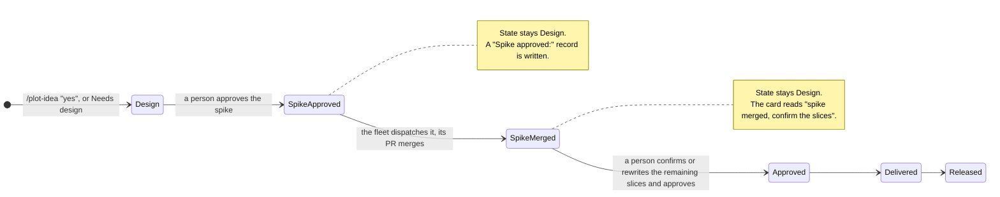
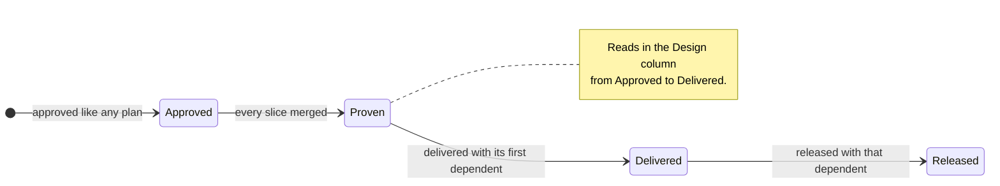

# Workflow phases — design spec

The phases of a team's workflow are configuration. Plot knows plan states, story statuses and three plan markers, and a declared mapping turns those facts into the board's phases. Plot ships the five phases of the agentic workflow as the default.

> **Story:** [Plot works in five phases](STORY-plot-works-in-five-phases.md)
>
> **Decisions:** every decision in this spec is one of the twelve that jwloka made on 2026-10-12, numbered as in the story's Decisions table (D1 to D12). A detail that no decision settles is marked *proposed* and listed in the story's Open Points.

## Contents

| § | Section | Answers |
|---|---|---|
| 1 | [Today's state](#1-todays-state) | what the code does on `main` at `75f093cb9` |
| 2 | [The phase model](#2-the-phase-model) | the config key, its format, the default, who reads it |
| 3 | [State to phase](#3-state-to-phase) | where each plan state and story status renders |
| 4 | [Design work](#4-design-work) | the optional Design phase, the spike and the tracer bullet |
| 5 | [The three tabs](#5-the-three-tabs) | Discovery, Planning and Delivery, with lanes, filters and toggles |
| 6 | [The fleet's work](#6-the-fleets-work) | what the fleet does in Design and in Testing |
| 7 | [What stays human](#7-what-stays-human) | approval, release, the spike and the design decision |
| 8 | [Domain rules](#8-domain-rules) | the new and changed rules, per plan |
| 9 | [Out of scope](#9-out-of-scope) | what this story does not change |

## 1. Today's state

Measured on `main` at `75f093cb9`, 2026-10-12.

- `packages/domain/src/entities/workflow.ts:35` declares `BOARD_PHASES = ['Discovery', 'Design', 'Development', 'Testing', 'Released']` as a constant. `PHASE_LEADERSHIP` (`:62`) and `PHASE_WORKFLOWS` (`:143`) are records keyed by those five names.
- `rules/phase.ts:41` `toBoardPhase` maps `draft` to Discovery, `design` to Design, `approved` to Development, `delivered` to Testing and `released` to Released, and `rejected` and `superseded` to `null`. `rules/phase.ts:72` `storyPhase` maps story `draft` to Discovery, `ready` to Design, `active` and `paused` to Development, `in-review` to Testing and `done` to Released. `rules/phase.ts:99` `rowPhase` composes `toBoardPhase`.
- `packages/board/src/server/board.ts:2082-2117` moves a plan whose `planStatus` (`rules/phase.ts:147`) is `deliverable` into the column of `toBoardPhase('delivered')`.
- Seven plan states exist: `draft`, `design`, `approved`, `delivered`, `released`, `rejected`, `superseded` (`transitions/plan.ts:22`, `entities/plan.ts:100-118`, `rules/phase-gate.ts:4-20`). `skills/plot/scripts/plot-plan-meta.sh:94` documents `design` as a phase of its own, and `:246` reads a `Design:` record.
- No command writes `State: Design`. The state gate's `owningCommand` (`rules/state-transition.ts:93`) names only `/plot-approve` and `/plot-deliver` for a plan, so a commit that changes `Draft` to `Design` in an existing plan is refused. The board's *Commission design* route (`packages/board/src/server/commission.ts:136-177`) asks an agent to make that edit and to add an empty `## Spec` section.
- The board has three tabs, `stories`, `plans` and `agents` (`packages/board/src/app/App.tsx:118`, `?tab=`; `?tab=board` redirects to `plans`).
- The tracker port lists open issues only (`ports/tracker.ts:108`). `Issue` carries no assignee and no closing date by stated design (`entities/issue.ts:21-23`), and the status write refuses to widen to a label or an assignee (`ports/tracker.ts:31-41`).
- The fleet dispatches `approved` plans only (`rules/eligible.ts:43`) and treats `delivered` and `released` as finished (`rules/eligible.ts:61`).

## 2. The phase model

### What Plot knows

Plot knows three kinds of fact, and only these (D12):

| Fact | Values | Where it is written |
|---|---|---|
| Plan state | `draft`, `design`, `approved`, `delivered`, `released`, `rejected`, `superseded` | `State:` in the plan's `## Status` block |
| Story status | `draft`, `ready`, `active`, `in-review`, `paused`, `done` | `status:` in the story's front matter |
| Plan marker | `design` (the state itself), `spike` (on one slice), `tracer` (on the plan) | the plan file, see §4 |

A phase name is not a Plot fact. It comes from the operator's workflow.

### The key

A `## Plot Config` key declares the phases (D12). The key name and its value grammar are *proposed* here.

```markdown
- **Workflow phases:** Discovery = story:*; Design = plan:draft, plan:design; Development = plan:approved; Testing = plan:delivered; Released = plan:released
```

- Entries are separated by `;`. The order of the entries is the order of the board's columns.
- Each entry is `<phase name> = <member>, <member>, …`.
- A member is `plan:<state>` or `story:<status>`. `story:*` means every story status. The prefix is required, because `draft` is both a plan state and a story status.
- Each plan state and each story status belongs to at most one phase. A state or status that no phase holds is not on the board.
- `plan:rejected` and `plan:superseded` cannot be declared. They stay off the board (D2).
- A phase name is any text without `;`, `=` or `,`.

The shape follows `Local checks`, whose `;`-separated `pattern = command` value `rules/local-checks.ts` parses as a value.

### The default

A repository that declares no `Workflow phases` key gets the five phases of the agentic workflow (D1, D2, D12). The default is the value shown above. Plot's own `CLAUDE.md` declares the same value explicitly (D12).

### A declaration that does not parse

The parse rule returns either a phase map or a refusal that names the entry and the reason (for example `plan:approved is in two phases: Development, Testing`). On a refusal the board renders the default map and shows the refusal text above the columns. It never renders a partial map.

### Who reads it

| Reader | Reads | Never reads |
|---|---|---|
| The board server | the key, through the plan store's `config(key, fallback)` | — |
| The domain | the parsed map, as a value (`phaseOfPlan(map, readings)`) | the key text or the config port |
| The fleet | plan states, story statuses and markers | phase names (D12) |
| The skills | plan states | phase names |

The domain rule takes readings as values, as CLAUDE.md's note on shape requires: the board reads the key, the domain parses and answers, and no rule awaits a port.

`PHASE_LEADERSHIP` stays keyed by the five default names. A declared phase whose name is not one of them renders with no leadership badge (*proposed*). `PHASE_WORKFLOWS` is derived from the map: a lifecycle workflow belongs to the phase that holds the state it moves a plan out of. With the default map, `approve` belongs to Design, `dispatch`, `implement` and `deliver` to Development, and `release` to Testing, which is the assignment the constant holds today.

## 3. State to phase

### Plans

With the default map (D2):

| Plan state | Phase | Change from today |
|---|---|---|
| `draft` | Design | was Discovery |
| `design` | Design | — |
| `approved` | Development | — |
| `delivered` | Testing | — |
| `released` | Released | — |
| `rejected`, `superseded` | not on the board | — |

Three readings refine the state, in this order:

1. **A tracer plan** reads in the phase that holds `plan:design`, in every state but `released` (D5). It never reads in Development or Testing.
2. **A deliverable plan** (`planStatus` is `deliverable`: approved, every non-deferred slice merged) reads in the phase that holds `plan:delivered`. This is today's auto-bump, expressed against the map. The plan file does not change.
3. **Every other plan** reads in the phase that holds its state.

The plan file keeps its state words. Only the mapping changes (D2).

### Stories

With the default map every story status is in Discovery (D1). Discovery holds only stories, and plans move through Design, Development, Testing and Released.

| Story status | Phase | Change from today |
|---|---|---|
| `draft` | Discovery | — |
| `ready` | Discovery | was Design |
| `active`, `paused` | Discovery | was Development |
| `in-review` | Discovery | was Testing |
| `done` | Discovery | was Released |

## 4. Design work

### The Design phase is optional

Only a plan with significant design decisions gets design work (D3). Design work is two things: a design spec, written in the plan's `## Spec` section, and a spike slice that runs before the remaining slices are confirmed. A Draft plan with no design work also reads in the Design column, where it waits for approval (D3).

A plan enters `State: Design` in two ways, and the fleet decides neither (D3):

- **At creation.** `/plot-idea`'s ceremony step asks *"Does this plan carry significant design decisions?"* On yes it writes `State: Design` and an empty `## Spec` section instead of `State: Draft`. A new file passes the state gate, because the gate admits a creation.
- **Later.** A person runs the *Needs design* controller action on a Draft plan (the board shows it as a *Needs design* button). The action moves `Draft` to `Design`, writes a `Design:` record (`<date>, <who>, <channel>`, the field `plot-plan-meta.sh:246` already reads), adds the empty `## Spec` section, and leaves a receipt that the state gate accepts.

An empty spec is a `## Spec` section that is absent or holds only the placeholder `_To be filled in during Design._`, which is the shape *Commission design* writes today (`commission.ts:136-177`).

### The spike

A plan in Design names one slice as its spike (D4), with an annotation on the branch line in the shape of `waits:` and `agent:`:

```markdown
- `feature/the-seam-holds` <!-- spike --> — prove the seam against the real host
```



- **A person approves the spike alone.** The approval writes a `Spike approved:` record (`<date>, <who>, <channel>`) and leaves `State: Design`. The spike slice becomes dispatchable. Every other slice of the plan stays undispatchable.
- **The fleet dispatches the spike like any slice** (D4, D10). Its PR is real code, and it lands on the default branch.
- **The plan stays in Design after the merge.** A person then confirms the remaining slices, or rewrites them, and approves the plan. The confirm action writes a `Slices confirmed:` record and the usual `Approved:` record, and the plan moves to Development.
- **Approval refuses a plan whose spike has not merged.** The refusal names the two ways forward: wait for the spike's merge, or remove the `spike` annotation.

### The tracer bullet

A tracer-bullet plan is a full plan that proves a path other plans need (D5). It carries `Type: tracer` in its `## Status` block.

- It is approved and dispatched like any plan.
- It reads in the Design column in every state but `released` (§3).
- When all its slices merge, its status reads `proven`.
- A dependent plan waits on it through the existing `waits:` annotation (`docs/plans/2026-09-01-a-slice-can-wait-on-another-plan.md`): a dependent slice names a tracer branch, and the merge of that branch unblocks it. This mechanism needs no change.
- It is released with the first dependent that ships. Automatic delivery skips a tracer plan. When `/plot-deliver` delivers a plan with a slice that waits on a branch of a proven tracer plan, it delivers that tracer plan in the same step, and the next release carries both (*proposed*).



## 5. The three tabs

The board has three tabs, Discovery, Planning and Delivery (D6). The names are fixed in the board and no config key changes them.

| Tab | URL | Replaces | Old URLs that redirect |
|---|---|---|---|
| Discovery | `?tab=discovery` | Stories | `?tab=stories` |
| Planning | `?tab=planning` | Plans | `?tab=plans`, `?tab=board` |
| Delivery | `?tab=delivery` | Agents | `?tab=agents` |

### Discovery

The Discovery tab shows the tag cloud, a tickets lane group and a stories lane group, as separate lanes (D7).

**Ticket lanes.** Open, In progress and Done. A ticket's lane comes from the tracker's own status category first (Jira). Where the tracker has none (GitHub Issues):

| Ticket | Lane |
|---|---|
| category `To Do` | Open |
| category `In Progress` | In progress |
| category `Done` | Done |
| no category, open, no plan's `Issue:` names it | Open |
| no category, open, a plan's `Issue:` names it | In progress |
| no category, closed | Done |

Done shows tickets closed in the last 14 days.

**Story lanes.** Draft holds `draft`, `ready` and `paused`. Active holds `active` and `in-review`. Done holds `done` stories that are not archived.

**The released toggle.** One tab-wide toggle shows released and archived items: an Archived lane with every archived story, and every closed ticket in Done.

The tracker port lists closed issues, and the board reads them through the index (D7). The fleet stays the index's one writer.

### Planning

The Planning tab keeps the sprint filter, the story filter, the *Story lanes* toggle and *Only my work* (D8). Its columns are the declared phases that hold plan states, in declared order. With the default map those are Design, Development and Testing. A *Show released* checkbox, off by default, adds the phase that holds `plan:released`.

### Delivery

The Delivery tab is today's Agents tab (D9).

- **Waiting on you** keeps today's content: tickets, broken agents, and Draft plans with no branch. By default its ticket rows show only tickets assigned to the current user. This needs the tracker's assignee on `Issue`, a read the entity refuses today (§1). D9 decides the read.
- **Active sprint** is a toggle. On, the tab shows only the plans of the active sprint and their items: PRs, branches, builds and agents.
- **Only my work** filters tickets, branches, PRs, plans and builds associated with the current user.

## 6. The fleet's work

The fleet reads plan states and markers. It never reads a phase name (D12).

### In Design

- **The spec.** For a plan in `State: Design` whose spec is empty, the fleet commissions an agent to write the spec (D10). This is today's *Commission design* agent, started by the fleet instead of a button, with a prompt that writes the spec instead of an empty section.
- **The spike.** After a person approves a spike, the fleet dispatches it (D10). Automatic dispatch reads the `Spike approved:` record and the `spike` marker as the eligibility of that one slice.
- **The approval stays a person's act** (D10). The fleet approves no spike and no plan.

### In Testing

For each Delivered plan the fleet runs a verification panel against the merged work on the default branch (D11):

1. Each Changelog entry and acceptance claim of the plan is one claim. Each juror judges a claim `supported` or `refuted`, through the `plot-panel` mechanism and the vocabulary `/plot-deliver` step 5 already uses.
2. The fleet writes a verification record into the plan: a `Verified:` line in `## Status` and a `## Verification` section with one line per claim.
3. The fleet opens one issue per refuted claim, labelled `ai-generated`, through the tracker port. This is a new write to a tracker, which D11 decides.
4. A plan with a refuted claim is flagged on the board.
5. The fleet produces a manual release checklist for the endgame round of human testing, building on the checklist `/plot-release rc` writes to `docs/releases/v<version>-checklist.md`.

Release stays a person's act (D11). The fleet fills no sign-off line, which `/plot-release` already forbids an agent.

## 7. What stays human

| Act | Who | Decision |
|---|---|---|
| Deciding that a plan needs design | a person, at `/plot-idea` or with *Needs design* | D3 |
| Approving a spike | a person | D4 |
| Confirming the slices after a spike and approving the plan | a person | D4, D10 |
| Approving any plan | a person | D10 |
| Releasing | a person | D11 |
| Declaring the phases | the operator, in `## Plot Config` | D12 |

## 8. Domain rules

Every view state in this story is a domain property, per CLAUDE.md's *Every rendered state is a domain property*.

| Rule | New or changed | Plan |
|---|---|---|
| `parsePhaseMap(value)`, `DEFAULT_PHASE_MAP` | new | `the-phases-are-declared` |
| `phaseOfPlan(map, readings)`, `phaseOfStory(map, status)` | new; replace `toBoardPhase` and `storyPhase` | `the-phases-are-declared` |
| `phaseWorkflows(map)` | new; replaces the `PHASE_WORKFLOWS` constant | `the-phases-are-declared` |
| `needsDesign(plan, input)` | new transition, `draft` to `design` | `the-phases-are-declared` |
| `owningCommand` | changed; names *Needs design* for `design` | `the-phases-are-declared` |
| `spikeOf(plan)`, `approveSpike(plan, input)` | new | `design-work-proves-the-path` |
| `approve` | changed; refuses `spike-unmerged`, records `Slices confirmed:` | `design-work-proves-the-path` |
| `sliceVerdict` | changed; an approved spike of a Design plan is dispatchable | `design-work-proves-the-path` |
| `planStatus` | changed; adds `proven` for a tracer plan | `design-work-proves-the-path` |
| `boardTabOf(param)` | new | `the-board-has-three-tabs` |
| `planningColumns(map, showReleased)` | new | `the-board-has-three-tabs` |
| `waitingTickets(issues, reader)`, `activeSprintScope(rows, sprints)` | new | `the-board-has-three-tabs` |
| `ticketLane(issue, namedByPlan, now)`, `storyLane(story)` | new | `tickets-and-stories-have-lanes` |
| `specIsEmpty(planText)`, `designWork(plan)` | new | `the-fleet-writes-the-design` |
| `verificationOf(plan)`, `refutedClaims(record)` | new | `the-fleet-verifies-what-it-delivered` |

## 9. Out of scope

- **Renaming plan states.** Plan files keep `Draft`, `Design`, `Approved`, `Delivered` and `Released` (D2). No plan file changes.
- **Configurable tab names.** The three tab names are fixed (D6).
- **A fleet that decides design.** The fleet never moves a plan into Design and never approves (D3, D10).
- **A fleet that releases.** Release stays a person's act (D11).
- **New story statuses.** The six statuses stay. The story lanes group them (D7).
- **Sprint states.** `Planning`, `Committed`, `Active` and `Closed` (`entities/sprint.ts:9`) are not phases and are not in the map.
